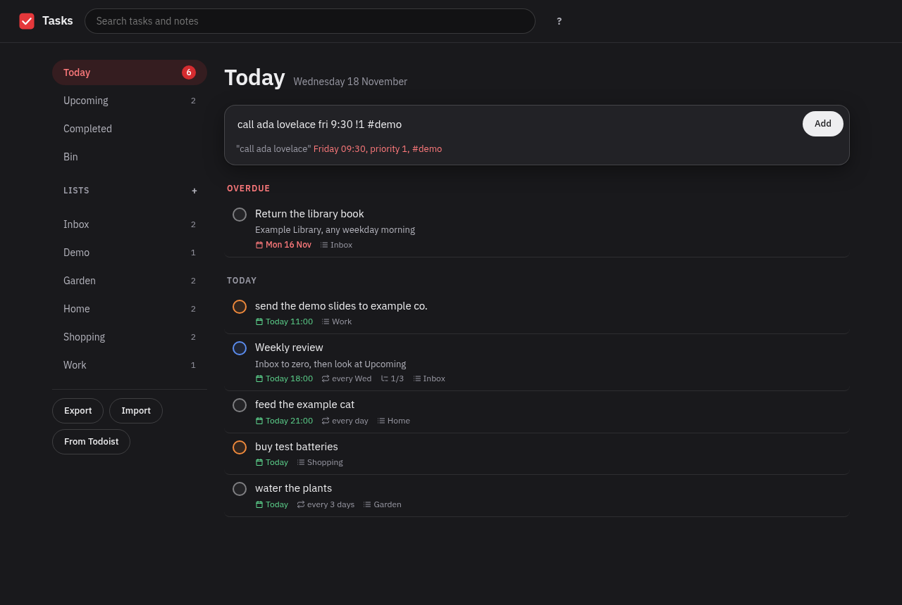

<div align="center">

# Starfire Tasks

**Your own free take on Todoist and Google Tasks. To-do lists with due dates, priorities, subtasks, repeats and a quick add line that understands "dentist fri 9:30 !1 #health", kept in one SQLite file on your own server.**

[](https://www.python.org/)
[](https://flask.palletsprojects.com/)
[](https://sqlite.org/)
[](LICENSE)

</div>



---

## Overview

Starfire Tasks is a small self-hosted to-do app. It has its own sign-in for one
owner account, so a copy runs on its own. It can also sit behind a sign-in
proxy: the author runs it behind the starfire sign-in like Keep Notes and
Read Later, where Caddy checks the sign-in, then passes the request to
Starfire Tasks on `127.0.0.1`.

- **Tasks** with a title, notes, a due date with an optional time, and a
  priority from 1 (highest) to 4 (lowest, the default).
- **Lists**: every task starts in the **Inbox** unless you pick a list.
  Deleting a list moves its tasks to the bin; restoring them puts them in the
  Inbox.
- **Subtasks**, one level deep, at most 500 per task (done and binned ones
  count). Completing a task completes its open subtasks; marking it not done
  again reopens exactly those, and the ones finished before stay done.
- **Repeats**: every day, every weekday, weekly on chosen days, monthly on a
  day, or every N days. Completing a repeating task makes the next one.
- **Quick add**: type the whole task in one line (see below). The line shows
  what it understood before you press Enter.
- **Views**: Today (with overdue tasks first), Upcoming (the next 7 days, by
  day), each list, Completed and the Bin. **Search** looks through titles and
  notes in every list (SQLite FTS5, every word must match, prefixes allowed).
  A view shows at most 500 tasks and says so when there are more.
- **Bin**: binned tasks can be restored, and are deleted for good after 30
  days.
- **Keyboard keys**: `q` add, `j` / `k` next and previous, `x` done, `e` edit,
  `Del` bin, `t` Today, `u` Upcoming, `i` Inbox, `c` Completed, `/` search,
  `?` the list.
- **Export and import** everything as one JSON file, and **import a Todoist
  CSV export**.
- A small **JSON API for Arty** (`/api/v1`): what is due today, add a task
  by quick add text, complete a task.
- Works on a phone: one column, views and lists in a row at the top.

Dates are worked out in `Europe/London` (set `TIME_ZONE` to change it), so
"today", "tomorrow" and overdue follow the UK clock, summer time included.
Due dates and times are stored as the wall-clock date and time you chose, so
a task "every day at 09:00" stays at 09:00 across the clock changes.

---

## Quick add

Everything that is not understood stays in the title. Only the first date,
time, repeat, priority and list in the line are used.

| You type | It means |
|---|---|
| `call mum tomorrow 5pm` | due tomorrow at 17:00 |
| `dentist fri 9:30 !1 #health` | due on Friday at 09:30, priority 1, in the list `health` |
| `pay rent every month on the 1st` | repeats monthly on the 1st, first due on the next 1st (today if today is the 1st) |
| `today`, `tomorrow`, `tmrw` | that day |
| `mon` ... `sun`, `monday` ... `sunday` | the next such day after today (on a Friday, `fri` is a week away) |
| `next mon` | Monday of next week (Monday to Sunday weeks), so on a Monday it is 7 days away |
| `next week` | Monday of next week |
| `in 3 days`, `in 2 weeks` | counted from today |
| `1 dec`, `1st of december`, `dec 1`, `25/12`, `25/12/2027`, `2027-12-25` | that date; without a year, the next time it comes round (`29 feb` finds the next leap year). Days that do not exist (`31 nov`, `29 feb 2027`) stay in the title |
| `5pm`, `5 pm`, `5:30pm`, `5:30 pm`, `17:00`, `9:30`, `at 9`, `noon` | that time; a time with no date is today, or tomorrow if that time has already passed |
| `daily`, `every day` | repeats every day |
| `weekdays`, `every weekday` | Monday to Friday |
| `weekly`, `every week` | weekly on the start day's weekday |
| `every mon, wed and fri` | weekly on those days |
| `monthly`, `every month`, `every month on the 15th`, `every 15th` | monthly on that day; the 29th to 31st fall on the last day of shorter months and come back the next month |
| `every other day`, `every 3 days` | every N days (1 to 365) |
| `!1` ... `!4` | priority |
| `#name` | the list (made if it does not exist yet; starts with a letter, so `#123` stays in the title) |
| `"Friday Night Lights"` | words in double quotes always stay in the title |

Some of these are ordinary words too: `daily`, `weekly`, `monthly` and
`weekdays` on their own, `sun`, `sat` and `wed`, and a date with a slash and
no year (`24/7`, `1/2`). They only count at the end of the line or when the
next word is understood as well (a time, date, repeat, `!1` or `#list`), so
`weekly review`, `buy sun cream` and `add 1/2 cup sugar` stay whole titles,
while `review weekly`, `party sat 8pm` and `x 25/12 !1` are read as before.
With `every` or `on` in front (`every week`, `on sun`) they always count.

A repeat with a time that has already passed today starts tomorrow, so
`water plants every day 9am` typed at 10:00 is first due tomorrow at 09:00.

When a repeating task is completed, the next due date is the first one after
its due date that is also today or later: finishing a daily task that is
three days overdue makes the next one due today, not three more overdue
copies. Completing it twice does not make two. Marking it not done again
moves the next one to the bin (unless that one is already done). A repeat
that would go past 31 December 2999 simply ends.

---

## Requirements

- Python 3.11+
- The time zone data for `TIME_ZONE` (on Debian the `tzdata` package, there
  by default). The app refuses to start with a clear message if it is missing.

---

## Install and run on your own machine

```bash
git clone <this repo> tasks
cd tasks
python3 -m venv .venv
.venv/bin/pip install -r requirements.txt
cp .env.example .env
.venv/bin/python -m tasks
```

Then open `http://127.0.0.1:8100` and make the owner account (see below).
Tasks are stored in `./data`.

`AUTH_MODE=local` switches the sign-in off for a copy only you use on this
machine: it then refuses to listen on anything but `127.0.0.1`, `::1` or
`localhost`.

---

## First run and sign-in

Starfire Tasks has its own sign-in, switched on by default (`AUTH_MODE=builtin`).
There is one owner account and no sign-up page.

1. Start it (`.venv/bin/python -m tasks`) and open
   `http://127.0.0.1:8100`. With no account yet every page goes to
   **Set up**.
2. The app writes a one-time setup code to its log when it starts, a line
   like `no owner account yet: open /setup and enter the setup code ...`.
   Enter that code, a user name and a password (10 characters or more,
   twice). The code stops anyone else who reaches the page first from
   making the account, and it works once: if the owner file is ever
   deleted, the next visit to **Set up** writes a new code to the log.
3. After that, every page goes to **Sign in** until you sign in. A session
   lasts 30 days. `/signout` signs out on every device.

How it is protected:

- The password is stored as an scrypt hash in `DATA_DIR/owner.json`
  (mode 600), never in plain text.
- 5 wrong passwords or setup codes from one address within 15 minutes lock
  that address out for the rest of the 15 minutes (`429`). Attempts sent
  at once are counted before they are checked, IPv6 addresses count by
  their `/64` network, and after 100 failures from everywhere within 15
  minutes each address gets one try and each network three (IPv4 by `/24`,
  IPv6 by `/48`). A right password from a locked address is refused too.
- During such an attack one wrong password from a neighbour on the same
  provider network does not keep your new browser out: that takes three
  wrong passwords within 15 minutes from three of their addresses (IPv4)
  or three of their home lines (IPv6, where a line's whole `/56` counts as
  one address).
- A browser that has signed in before keeps a signed device cookie and has
  its own 5 tries, so a stranger who locks out your address (or the
  address of the proxy in front) cannot lock you out of that browser.
  During an attack from many networks that browser is the way in.
  Making a new owner account ends every device cookie of the old one.
- The session cookie is `HttpOnly`, `SameSite=Lax` and signed with the app's
  secret key. It is `Secure` everywhere except plain `http` on `localhost`,
  `127.0.0.1` or `[::1]` (`SECURE_COOKIES=auto`). On a plain `http` address
  on your home network the browser drops a `Secure` cookie and the sign-in
  page says so: use https, or set `SECURE_COOKIES=false` there.
- Forget the password? Stop the app, delete `DATA_DIR/owner.json`, start it
  again and set up a new owner with the new setup code from the log. Your
  data stays.

Behind a reverse proxy for https, with the own sign-in still on: list the
proxy's address in `TRUSTED_PROXIES` so the lockout counts each visitor's
address from `X-Forwarded-For` instead of the proxy's (the header is read
only from those addresses), and put the public host name in
`ALLOWED_HOSTS`. By default the own sign-in answers only on `localhost`,
`127.0.0.1`, `[::1]`, IP addresses and this machine's own name; any other
`Host` gets `421`, so a web page cannot reach a copy on your machine by
DNS rebinding.

To run it behind a sign-in proxy instead, set `AUTH_MODE=proxy` and list the
proxy's address in `TRUSTED_PROXIES`. The user header is then believed only
from those addresses; in the default mode it is never read.

---

## Configuration (`.env` or environment)

| Key | Description |
|---|---|
| `AUTH_MODE` | `builtin` (default): the app's own sign-in, one owner account. `proxy`: trust the user header from a sign-in proxy listed in `TRUSTED_PROXIES`. `local`: no sign-in, loopback only, and only for the host names `localhost`, `127.0.0.1` and `[::1]` with `PORT` (any other `Host` gets 421, so a web page cannot reach the app by DNS rebinding). |
| `BIND_HOST` / `PORT` | Where the app listens. Default `127.0.0.1:8100`. |
| `DATA_DIR` | Database (`tasks.db`), the owner account (`owner.json`) and the secret key (`secret_key`). Default `./data`. |
| `TRUSTED_PROXIES` | Addresses or networks whose user header is believed in `proxy` mode, comma separated. No default: `proxy` mode refuses to start without it. A network with host bits set (`10.0.0.16/24`) or one that reaches public addresses (`0.0.0.0/0`, `::/0`) stops the app at start-up; a single public address is allowed. In `builtin` mode, the proxies whose `X-Forwarded-For` gives the visitor's address to the lockout. |
| `ALLOWED_HOSTS` | In `builtin` mode, the only host names the app answers on, comma separated (others get 421). Empty: `localhost`, `127.0.0.1`, `[::1]`, IP addresses and this machine's own name. |
| `SECURE_COOKIES` | `auto` (default): the session cookie is `Secure` except on plain `http` to `localhost`, `127.0.0.1` or `[::1]`. `true` or `false` force it. Only used in `builtin` mode. |
| `USER_HEADER` | The header the proxy fills in. Default `X-Forwarded-User`. |
| `ALLOWED_USERS` | Optional comma separated list; any other user header value is refused. |
| `LOCAL_USER` | The user name shown in `local` mode. Default `local`. |
| `SECRET_KEY` | Optional. Without it a random key is made once in `DATA_DIR/secret_key` (mode 600). A key or key file shorter than 32 bytes stops the app at start-up. |
| `TIME_ZONE` | The zone "today" and due times are worked out in. Default `Europe/London`. |

---

## How sign-in and writes are protected

- In `builtin` mode (the default) a request is signed in only with the
  owner's session cookie; see [First run and sign-in](#first-run-and-sign-in).
  A user header is never read.
- In `proxy` mode a request is only signed in when it comes from an address
  in `TRUSTED_PROXIES` **and** carries a non-empty `USER_HEADER`. The same
  header sent from anywhere else is ignored and the request gets `401`.
  Every page and API call needs it except `/api/health`.
- The Caddy block in `deploy/` removes any `X-Forwarded-User` the visitor
  sends, checks the starfire session with `forward_auth` against
  `/api/auth/users` (the admin account only), and then sets
  `X-Forwarded-User` itself, to `SIGNED_IN_USER` from `deploy/site.env`.
  `ALLOWED_USERS` in the server env file is set to the same name and makes
  Starfire Tasks refuse anything else.
- Every write (`POST`, `PATCH`, `DELETE`), the Arty API included, needs the
  `X-CSRF-Token` header from `/api/session`, an HMAC of the user made with
  the secret key. A write whose `Origin` is a different host is refused too.
- Pages ship a strict Content Security Policy (scripts, styles, fonts and
  images from the app itself only), `X-Frame-Options: DENY`, `nosniff` and
  `no-referrer`. API answers are `no-store`. Task text is always put on the
  page as text, never as HTML.
- All SQL is parameterised; search words are quoted before they reach FTS5,
  so no query syntax gets through. Requests are capped at 10 MB (waitress
  refuses a bigger body before the app or the sign-in check sees it), ids too
  big for SQLite answer 404, JSON nested too deeply answers 400, and text
  that is not valid Unicode (a lone surrogate) answers 400.
- Dates are checked on the way in (due dates 1900-01-01 to 2999-12-31,
  timestamps years 1 to 9999 in UTC) and read back tolerantly, so a damaged
  or odd row shows without a date instead of breaking a page.

---

## Export, import and backup

**Export** (the Export button, or on the server, where the app only believes
the header from `127.0.0.1` and only for the user in `ALLOWED_USERS`; `-f`
makes curl fail instead of saving a refusal as the file):

```bash
curl -f -H 'X-Forwarded-User: admin' -o tasks.json http://127.0.0.1:8100/api/export
```

The file holds every list and task, including done and binned ones, with
subtasks, repeats and dates. **Import** (the Import button) adds the tasks in
a file to the ones already there; it never replaces or deletes anything,
lists are matched by name, and a file with any bad task is refused as a
whole. One import request holds at most 10,000 tasks (subtasks included),
1,000 list names and 10 MB, so the page sends a bigger export in parts of
whole tasks: it first checks every part (`/api/import?check=1`, nothing is
saved) and only then imports them one after another. If a part fails after
the check (for example the server stops), the parts before it stay imported
and the message says how many tasks went in. The one export the page cannot
send is a single task whose own JSON is over 10 MB (500 subtasks with nearly
full notes in a non-Latin script); `curl` posts to `/api/import` are not
split.

**From Todoist**: in Todoist, export a project as a CSV file, then press
**From Todoist**.
The tasks go into a list named after the file (`Shopping.csv` goes into
`Shopping`). What is read: `TYPE` task rows (`CONTENT` the title,
`DESCRIPTION` the notes, `PRIORITY` 1 to 4, `INDENT` 2 or more a subtask of
the task above), `note` rows (added to the task's notes) and the `DATE`
column, read with the quick add rules above. A `DATE` that cannot be read
whole (for example `every 2nd tuesday`) is kept in the notes as
`Todoist date: ...` and the task gets no date. Sections are skipped. A file
with any bad row is refused as a whole. The column names and the priority
numbering (1 = p1, the highest) follow Todoist's CSV template; they were not
checked against a real export file from a Todoist account.

**Backup of the database.** SQLite's online backup makes a consistent copy
even mid-write. On the server, run it as root; the copy itself runs as the
service user, because opening the database while the app is stopped creates
`-wal` and `-shm` files, and if root made them the app could no longer write:

```bash
copy_dir="$(mktemp -d)" && chown tasks:tasks "$copy_dir"
runuser -u tasks -- python3 -I - /var/lib/tasks/tasks.db "$copy_dir/copy.db" <<'PY'
import sqlite3, sys
source = sqlite3.connect(f"file:{sys.argv[1]}?mode=ro", uri=True)
copy = sqlite3.connect(sys.argv[2])
source.backup(copy)
copy.close()
source.close()
PY
mv "$copy_dir/copy.db" /root/tasks-$(date +%F).db && rmdir "$copy_dir"
```

**Restore** (server commands, untested on the server): stop the app, put the
copy in place as `tasks.db`, give it back to the service user, start the app:

```bash
systemctl stop tasks
install -m 600 -o tasks -g tasks /root/tasks-2026-11-13.db /var/lib/tasks/tasks.db
rm -f /var/lib/tasks/tasks.db-wal /var/lib/tasks/tasks.db-shm
systemctl start tasks
```

---

## Deploy behind starfire

> **UNTESTED.** `deploy.sh` and this section were written without touching
> the live server. Read the script before running it.

On that server Starfire Tasks trusts the gate instead of its own sign-in:
`deploy/tasks.env` sets `AUTH_MODE=proxy` and
`TRUSTED_PROXIES=127.0.0.1,::1`.

`deploy.sh` installs Starfire Tasks into a Proxmox container that already runs Caddy
and the starfire sign-in, reached with `ssh` and `pct`. The values for your
own setup live in `deploy/site.env`, which git ignores. Copy
`deploy/site.env.example` and fill it in:

| Key | Description |
|---|---|
| `PROXMOX` | The ssh host name of the Proxmox machine. |
| `CT` | The number of the container that runs Caddy. |
| `SITE_HOST` | The host name Starfire Tasks is served on, like `tasks.example.com`. |
| `SIGNED_IN_USER` | The starfire admin account name; Caddy passes it on and it becomes `ALLOWED_USERS`. |

What it sets up, matching Keep Notes and Read Later:

| Piece | Where |
|---|---|
| Code and venv | `/opt/tasks` (root owned) |
| Tasks | `/var/lib/tasks` (user `tasks`, mode 700) |
| Settings | `/etc/tasks/tasks.env` (root:tasks 640), from `deploy/tasks.env` |
| Service | `tasks.service` from `deploy/tasks.service`, on `127.0.0.1` at `PORT` from the env file (8100 by default, the next after 8097, 8098 and 8099), sandboxed, `MemoryMax=256M` |
| Sign-in page | `/srv/signin/tasks`, built by `deploy.sh` with the sign-in page builder in `SITE_SIGNIN` |
| Caddy | the `http://SITE_HOST` block from `deploy/Caddyfile.tasks`, added once between the lines `# >>> tasks block, ...` and `# <<< tasks block`, with the port and the values from `deploy/site.env` filled in |

From your own machine:

```bash
./deploy.sh backup          # Caddyfile, any earlier install and a copy of the tasks into /root in the container
./deploy.sh apply           # install HEAD, start the service, add the Caddy block, then check
./deploy.sh check           # read the "check failures:" line, 0 is good
```

`apply` refuses to run before `backup` and refuses if another program already
listens on the port. The port has one source: `PORT=` in
`/etc/tasks/tasks.env` in the container (on a first install, `deploy/tasks.env`
from the repo, which then becomes that file). The Caddy block is filled in from
it, so moving the app to another port means changing that one line and running
`apply` again, which rewrites the marked block. An existing env file is kept.
The Caddyfile is checked with `caddy validate` before every reload and put back
if it does not validate, and the sha256 of every deployed file is compared with
the commit. If `systemctl reload caddy` fails, the Caddyfile is put back too,
so a block Caddy never loaded is never left on disk. With Starfire Tasks already
running, a `PORT` that another program listens on is refused as well (the
listener's process must be the tasks service's own). `check` also fails when
the marked block sends to another port than `PORT`. Each `apply` and `undo`
keeps the three newest of each kind of leftover (earlier and undone code in
`/opt`, earlier and undone sign-in pages in `/srv/signin`, Caddyfile copies
in `/etc/caddy`) and removes older ones; the database backups in `/root`
are never removed. Running `apply` again later updates the code in place and
keeps the tasks.

`./deploy.sh undo` puts back what the last `apply` changed: the earlier code
and sign-in page, or after a first install it stops and removes the service.
Every `apply` first forgets what the one before it did, so after an `apply`
that failed before changing anything (pip could not install, the port was
taken) `undo` says there is nothing to undo, and after an `apply` that failed
its health check it puts back only the code. A second `undo` also says there
is nothing to undo. `undo` never changes `/etc/tasks/tasks.env`; when the
Caddy block it puts back sends to another port than `PORT` there, it says so
and `check` fails until the two agree. In the Caddyfile it
takes out only the marked tasks block (or puts back that block's earlier
version if `apply` had rewritten it), validates, reloads, and puts the file
back if it does not validate. The other apps' blocks and any edits made since
stay as they are. A `SITE_HOST` block that was there before `apply`
is never touched. Tasks in `/var/lib/tasks` are never touched.

Steps by hand:

1. In Cloudflare Zero Trust, add a public hostname for `SITE_HOST` to the
   tunnel, pointing at port 80 of the Caddy container.
2. Sign in once at `https://SITE_HOST` with the starfire admin account.
3. Optionally add a Kuma monitor for `http://127.0.0.1:8100/api/health` in the container.

---

## API

Every path needs a signed-in session (in `proxy` mode, the signed-in user
header) except `/api/health` and the sign-in pages; writes also
need `X-CSRF-Token`.

### API for Arty (`/api/v1`)

These three answers are kept stable so other programs can rely on them.

| Method and path | Answer |
|---|---|
| `GET /api/v1/today` | `{"date": "2026-11-13", "timeZone": "Europe/London", "overdue": [...], "today": [...], "more": false}`: open tasks due before today, then due today, earliest first; at most 500, and `more` is `true` when there were more. |
| `POST /api/v1/tasks` with `{"text": "call mum tomorrow 5pm"}` | `201` and `{"task": {...}, "understood": {...}}`. The text is read with the quick add rules; `understood` says what was taken as date, time, repeat, priority and list. Text with no title left (`"tomorrow"`) answers `400`. |
| `POST /api/v1/tasks/<id>/complete` | `{"task": {...}, "next": {...} or null}`. `next` is the new task a repeat made. Completing a done task again changes nothing and answers the same. |

Each task:

```json
{
  "id": 7,
  "title": "call mum",
  "notes": "",
  "list": "Inbox",
  "parentTitle": null,
  "dueDate": "2026-11-14",
  "dueTime": "17:00",
  "dueAt": "2026-11-14T17:00:00Z",
  "priority": 4,
  "repeatText": null,
  "overdue": false,
  "completed": false
}
```

`dueDate` and `dueTime` are London wall-clock values; `dueAt` is the same
moment in UTC (or `null` without a time). `parentTitle` is set for a subtask.
Errors answer `{"error": "..."}` with `400`, `401`, `403`, `404` or `409`.

Writes need the CSRF token like every other write. A program gets it from
`GET /api/session` with the same user header; it stays the same until the
secret key changes. Example from the server itself (the app only believes
the header from `127.0.0.1`):

```bash
user=(-H 'X-Forwarded-User: admin')
token="$(curl -sf "${user[@]}" http://127.0.0.1:8100/api/session | python3 -c 'import json, sys; print(json.load(sys.stdin)["csrfToken"])')"
curl -sf "${user[@]}" http://127.0.0.1:8100/api/v1/today
curl -sf "${user[@]}" -H "X-CSRF-Token: $token" -H 'Content-Type: application/json' \
  -d '{"text": "call mum tomorrow 5pm"}' http://127.0.0.1:8100/api/v1/tasks
```

**Open question:** this API is guarded exactly like the rest of the app:
only the sign-in proxy's user header is believed, and only from
`127.0.0.1`. As deployed it is therefore only reachable from the server
itself (the app listens on `127.0.0.1` and Caddy lets in only a signed-in
browser), so a program on another machine, Arty's brain included, cannot
call it yet. That needs a decision first: a key of Arty's own, or a route
through Caddy.

### The app's own API

| Method | Path | Purpose |
|---|---|---|
| GET | `/api/health` | `{"ok": true}`, or `503` when the database cannot be read |
| GET | `/api/session` | Signed-in user, CSRF token, version, time zone, today's date and `importLimits` (tasks, lists and bytes one import may hold) |
| GET | `/api/lists` | Lists with their open task counts, plus counts for today, overdue, upcoming and the bin |
| POST | `/api/lists` | New list: `{"name": "Work"}` (names are unique, any case) |
| PATCH | `/api/lists/<id>` | Rename: `{"name": "Office"}` (not the Inbox) |
| DELETE | `/api/lists/<id>` | Delete the list, its tasks go to the bin (not the Inbox) |
| GET | `/api/tasks?view=today\|upcoming\|completed\|bin` | Tasks in that view (at most 500; `more` is `true` when there were more) |
| GET | `/api/tasks?view=list&list=<id>` | Open top-level tasks in a list, each with its subtasks |
| GET | `/api/tasks?view=search&q=plumber` | Search, done tasks included |
| POST | `/api/tasks` | New task: `title`, `notes`, `dueDate`, `dueTime`, `priority`, `listId`, `parentId`, `repeat` |
| POST | `/api/tasks/quick` | New task from quick add text: `{"text": "...", "listId": 3, "parentId": 7}` (both optional) |
| GET | `/api/parse?text=...` | What quick add would understand, without saving |
| GET | `/api/tasks/<id>` | One task |
| PATCH | `/api/tasks/<id>` | Change any of the fields above |
| POST | `/api/tasks/<id>/complete` | Done; `{"task", "next"}` |
| POST | `/api/tasks/<id>/uncomplete` | Not done; `{"task", "binned"}` (the next repeat it moved to the bin, if any) |
| POST | `/api/tasks/<id>/trash` | Move to the bin, subtasks too |
| POST | `/api/tasks/<id>/restore` | Take out of the bin, with the subtasks binned at the same time |
| DELETE | `/api/tasks/<id>` | Delete for good (only from the bin) |
| POST | `/api/bin/empty` | Delete every binned task |
| GET | `/api/export` | Download everything as JSON |
| POST | `/api/import` | Add the tasks from an export; `?check=1` only checks it and saves nothing (`{"checked": n}`) |
| POST | `/api/import/todoist?list=Name` | Add the tasks from a Todoist CSV export (the body is the CSV file) |

Field rules: `dueDate` is `YYYY-MM-DD`; `dueTime` is `HH:MM` in 24 hours and
needs a `dueDate`; `priority` is 1 to 4; sending `"dueDate": null` also clears
the time and the repeat. `repeat` is `null` or one of
`{"kind": "daily"}`, `{"kind": "weekdays"}`,
`{"kind": "weekly", "days": [0, 3]}` (0 is Monday),
`{"kind": "monthly", "day": 31}` or `{"kind": "interval", "days": 3}`, and
needs a `dueDate`. A subtask cannot repeat, cannot have subtasks of its own
and always stays in its parent's list. A binned task must be restored before
it can be changed.

---

## Tests

```bash
.venv/bin/pip install -r requirements-dev.txt
.venv/bin/python -m pytest -q
```

`tests/test_deploy.py` runs the server half of `deploy.sh` against a scratch
folder with `systemctl`, `caddy`, `runuser` and `chown` stubbed out, together
with the blocks of three other apps, and the laptop half with `ssh` and `scp`
stubbed out.

---

## Tech

- Flask served by waitress, SQLite in WAL mode with an FTS5 index.
- The standard library's `zoneinfo` for dates; no other dependencies.
- Plain HTML, CSS and JavaScript: no build step. The look and the colour
  tokens come from starfire, with the IBM Plex fonts bundled.

## License

MIT, see [LICENSE](LICENSE). The IBM Plex fonts are under the SIL Open Font License
(`tasks/static/fonts/LICENSE-ibm-plex.txt`).
